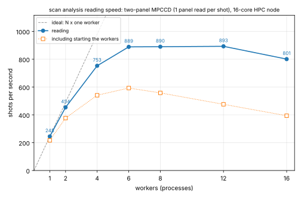

# Scan analysis

A scan is a series of runs, one per step of a scanned motor (e.g. the pump–probe delay;
see [Scans](run-logger.md#scans)). The scan analysis follows the signal in the
[ROIs](rois.md) through the scan, separately for pump on and pump off, and their ratio.
It exists twice, with the same ROIs, corrections and pump settings:

| | Online scan viewer | Offline scan analysis |
|---|---|---|
| Where | beamline (olpy, live) | HPC (stpy, stored runs) |
| Started with | `start_scan_viewer()` | `analyse_scan(...)` |
| Shots | as many as it can read while the scan runs | every shot of every step |
| Point and error bar | mean per step, Poisson error | median, 15.87 / 84.13 % quantiles (spread of the shots) |
| Reference (i0) | – | shot by shot, for every reference detector (per step: option) |
| Result | live plot | tables and plot in `<output>/scans/scan_<id>/` |

## Before a scan

1. **Dark, photon energy, threshold**: [Energy calibration, threshold and
   dark](energy-calibration.md). The ROI values are keV of deposited energy, so these must be
   right first.
2. **ROIs**: set them in the [MPCCD viewer](mpccd-viewer.md) with `add_roi` ([ROIs](rois.md)).
   On the HPC this is done on old data with the offline view,
   `start_mpccd_viewer(name=..., run=...)`, where `w` shows pump on and pump off separately.
3. **Pump detector**: the point detector that says whether the pump laser hits the sample,
   and its value for "pump on". Default: `optical_shutter` = 1.

    ```python
    set_pump("optical_shutter", on_value=1)   # the default
    set_pump(None)                            # no pump sorting: one curve
    ```

4. **Reference detectors** (offline analysis): the point detectors the ROI signal is divided by,
   e.g. the incoming intensity i0. One or several; they must be point detectors of the
   [configuration](detectors.md). None is assumed: without them the analysis is not
   referenced.

    ```python
    set_references("i0_1")                    # one
    set_references("i0_1", "i0_2")            # several (or a list)
    set_references()                          # none
    ```

5. **Run logger**: the scan viewer and the offline analysis take the runs of a scan from the
   [run log](run-logger.md). Online: `start_online_logger()` (the scan viewer also starts it
   if none is running); on the HPC: `make_runlog()`.

## Which shots are used

For every shot of every run of the scan:

- X-rays off (`xfel_shutter` = 0) or a bad beam status: dropped;
- pump state from the pump detector: on, off, or unknown (dropped);
- only the panels that the ROIs cover are read, and only the ROI pixels are corrected (dark,
  threshold) and converted to keV;
- the value of a ROI is its **keV per pixel** in this shot, so ROIs of different size compare;
- the value of every reference detector for this tag. A shot without a value for a reference
  is left out of **everything computed with that reference** (and used for the rest).

Repeated steps (the same motor position twice) are combined into one point.

## Online: the scan viewer

```python
start_scan_viewer()                 # new terminal, MPI: 1 display + 4 readers
start_scan_viewer(workers=8)        # more readers
start_scan_viewer(scan=1234501)     # follow a fixed scan (as scan_info) instead of the newest
start_scan_viewer(test=True)        # simulated scans (the default on a laptop)
logger_status()                     # is the run logger running?
```

The viewer follows the **newest scan** of the run log: when a new scan starts it clears the
plot and follows that one. Top: the mean keV per pixel per shot of every ROI for every step,
pump on solid and pump off dashed; bottom: on / off.

The error bars are Poisson errors from the number of photons, and are always calculated:
`e` only shows or hides them.

| Key | Action |
|---|---|
| `1` … `9`, `0` | show / hide ROI 1 … 10 |
| `e` | error bars on / off |
| `r` | read the scan again from the start |
| `q` | quit |

**Keeping up.** SACLA runs at up to 60 Hz, and the online buffer keeps a shot only for a
while. Reader *k* of *N* takes the shots with `(tag / tag_step) mod N == k` and works
newest-first: the new shots of the running step first, then back through older shots and
steps not read yet, as long as the buffer has them. A shot no longer in the buffer counts
as **lost**. The status line shows read / lost / dropped shots and the backlog; more readers
(`workers`) lose fewer.

## Offline: analyse_scan

```python
analyse_scan(1234501, max_tags=100)                # quick look: 100 shots per run
analyse_scan(1234501)                              # every shot (6 workers)
analyse_scan(-1)                                   # the newest scan of the run log
analyse_scan(1234501, show=False)                  # only save the plot (e.g. in a batch job)
analyse_scan(1234501, workers=8)                   # another number of workers
analyse_scan(1234501, name="octal")                 # the ROIs of another MPCCD array
analyse_scan(1234501, step_reference=True)         # also referenced per step
analyse_scan(1234501, pairs=True)                  # also on / off of nearest-off pairs
scan_result(1234501)                               # the per-step table (pandas)
scan_result(1234501, show=True)                    # also replots the data                        
```

`which` is as in `scan_info()`: `-1` the newest scan of the run log, `-2` the one before, or
any run number of the scan. `workers` (default 6) is the number of Python processes on the
node (at most the cores of your `bt_node`; no MPI needed). `name` is the MPCCD array whose
ROIs are used (default: the default array, `use_mpccd`). It runs in the session's terminal;
Ctrl-C stops it.

When it is done the plot opens (`show=True`, the default); on the HPC in the browser: the
terminal prints the `ssh` line and the link as for the viewers
([Plots on the HPC](hpc.md#plots-on-the-hpc-in-the-browser)). The session waits until you
press Ctrl-C there. `show=False` only saves the plot.

The same analysis for every pixel of the detector, saved as images to take home, is the
[Full-frame reduction](fullframe.md) (an HPC batch job).

### What is computed

Per step and pump state, from the shots' values: the **median** as the point and the
15.87 % and 84.13 % quantiles as the error bars, i.e. the range of the middle 68.3 % of the
shots. The error bars show the **spread of the shots**, not the uncertainty of the median
(which would be about √n smaller).

| Quantity | How | When |
|---|---|---|
| ROI | quantiles of the ROI values | always |
| reference R | quantiles of R | with references |
| ROI / R **per shot** | quantiles of ROI / R of every shot | with references |
| on / off | median on / median off: unreferenced and per shot referenced (every R) | with a pump detector |
| ROI / R **per step** | median(ROI) / median(R) of the shots with R, and its on / off | `step_reference=True` |
| on / off, **nearest-off pairs** | every pump-on shot divided by the nearest pump-off shot (by tag) of the same run, then the quantiles of these ratios: unreferenced and per shot referenced (every R) | `pairs=True` |

The options are off by default and only computed (and written, and plotted) when switched
on: run the analysis again with them to see them. `info.json` records which were used.

A ratio of two medians (on / off of medians, per step referencing) gets its error bars from
those of the two medians: their relative errors added in quadrature (the lower error of the
ratio from the lower error of the numerator and the upper error of the denominator, and the
other way round).

### The plot

One column of panels with the scan motor on the x axis; pump on solid, pump off dashed,
colour = ROI, marker = reference:

| Panel | Shows |
|---|---|
| ROI | the ROI values, keV per pixel per shot |
| ROI / R per shot | one panel per reference: the median of ROI / R |
| ROI / R per step | (`step_reference=True`) one panel per reference: median ROI / median R |
| on / off | ratio of the medians, per shot referenced (one marker per reference); per step referenced dash-dotted (`step_reference=True`); nearest-off pairs dotted (`pairs=True`). Without references: the unreferenced ratio instead (it is always in `steps.csv`) |

Without a pump detector there is no on / off panel.

### Files

Written to `<output>/scans/scan_<id>/`:

| File | Content |
|---|---|
| `scan_<id>.h5` | everything: group `shots` (the shot table), group `steps` (the step table), attribute `info` (JSON: scan, ROIs, references, corrections, photon energy, error bars, timing) |
| `shots.csv` | one row per shot: run, tag, step, motor value, `use`, `state`, `read`, `ref_<R>` for every reference, `roi_<name>` for every ROI (keV per pixel) |
| `steps.csv` | the quick look: one row per step with everything in the table above (names below) |
| `info.json` | the same as the h5 attribute `info` |
| `plot.png` | the plot |

Columns of `steps.csv` (`<s>` is `on`, `off`, or `all` without a pump detector; bounds are
absolute values, not distances):

| Column | Content |
|---|---|
| `x`, `step`, `value`, `runs`, `n_<s>` | step, motor value, runs, shots used |
| `<roi>_<s>_q16`, `_median`, `_q84` | ROI |
| `<roi>_ratio`, `_lo`, `_hi` | on / off of the medians, unreferenced |
| `<roi>_pair_ratio`, `_q16`, `_q84`, `n_pairs` | on / off of nearest-off pairs, unreferenced (`pairs=True`) |
| `<R>_<s>_q16`, `_median`, `_q84`, `n_<s>_<R>` | reference R, shots with R |
| `<roi>_per_<R>_step_<s>`, `_lo`, `_hi` | ROI / R per step (`step_reference=True`) |
| `<roi>_per_<R>_shot_<s>`, `_q16`, `_q84` | ROI / R per shot |
| `<roi>_per_<R>_shot_ratio`, `_lo`, `_hi` | on / off of the medians, per shot referenced |
| `<roi>_per_<R>_step_ratio`, `_lo`, `_hi` | on / off of the medians, per step referenced (`step_reference=True`) |
| `<roi>_per_<R>_pair_ratio`, `_q16`, `_q84`, `n_pairs_<R>` | on / off of nearest-off pairs, per shot referenced (`pairs=True`) |

The h5 file can be read with h5py or pandas, e.g.

```python
import h5py, json, pandas as pd
with h5py.File("scan_1234501.h5") as f:
    steps = pd.DataFrame({k: f["steps"][k][()] for k in f["steps"]})
    info = json.loads(f.attrs["info"])
```

### Time-tool binning

With time-tool binning the pump-on shots are sorted by their **corrected timing** instead of the
scan step ([Time tool](timetool.md)):

    t = scan motor value of the run + P(edge) - P(0)        (pulse; x ps_per_pulse: ps)

```python
set_tt_bins(on=True, bin_ps=0.05)        # on for every analyse_scan, bins of 50 fs
analyse_scan(-1, tt=True, bin_ps=0.02)   # or for one analysis only
set_tt_bins(sparse_min=30, sparse_hide=True)
```

- **Bins.** The bin width is given in ps and converted to pulses with `ps_per_pulse`. The first
  pump-on shot with a good edge (in run and tag order) is the centre of bin 0; every other shot
  goes into bin round((t - t0) / width), so bins are added in either direction as the shots need
  them (the same rule as online, where the bins grow during the scan).
- **Which shots.** Pump-on shots that were read and have a good edge in the [time-tool
  log](timetool.md#the-time-tool-log) (made with the current settings). Runs of the scan without
  a log are logged first, by the analysis itself (the HPC time-tool logger's code, `workers`
  processes, a line of progress per part). Shots with a bad edge are dropped and counted.
- **Pump on / off** stays step-wise: every pump-on shot is divided by the median of the
  pump-off shots of its scan step (repeated steps combined), and these ratios are binned. The
  pump-off shots themselves are not binned.
- **Per bin**: the shots, and the median and 15.87 / 84.13 % quantiles of the ROI, of ROI / R
  per shot for every reference, and of the on / off ratios.
- **Units.** The motor and the calibration should be in the same units (pulse); if their units
  in the config differ, a warning is printed and the analysis goes on.
- **Sparse bins**: fewer than `sparse_min` (20) shots. They stay in `bins.csv`; in the plot they
  are hidden (`sparse_hide`) or drawn with open markers. In the plot window `+` / `-` change
  `sparse_min` (x 1.25) and `h` hides / shows them; both are stored in the config and the png is
  saved again.

**The plot** (`plot_tt.png`, shown instead of `plot.png`): panels against time in ps. Pump on:
the bins (time-tool corrected), solid; pump off: per scan step at the step's motor value x
`ps_per_pulse` (not corrected: their timing means nothing), dashed with open squares, in the ROI
and ROI / R panels. The time axis is shifted so that the left-most pump-on bin is 0, and the
pump-off points are shifted on their own so that the left-most step is 0 too (both absolute
times are in the axis label). This removes the constant P(0) part of the correction between on
and off; the rest of the time-tool correction can still make them differ slightly. Below: the shots per bin with the sparse
limit. `plot.png` has its x axis in ps too (scan motor x `ps_per_pulse`).

Extra files with binning: `bins.csv`, `off_steps.csv`, the groups `bins` and `off_steps` in
`scan_<id>.h5`, `plot_tt.png`; `shots.csv` gets the timing columns; `info.json` the binning
(`tt_binning`).

#### The time-tool corrected data in the h5 file

| Group of `scan_<id>.h5` | One row per | Columns |
|---|---|---|
| `shots` | shot | `run`, `tag`, `step`, `value` (scan motor, pulse), `use`, `state` (0 on, 1 off), `read`, `ref_<R>`, `roi_<name>`; with binning also `edge` (camera px), `edge_good`, `shift_pulse` (P(edge) - P(0)), `t_pulse` (= value + shift_pulse), `t_ps` (= t_pulse x ps_per_pulse), `bin` (-1000000000: not binned), `roi_<name>_per_<R>`, `<column>_onoff` (pump-on shot / median off of its step) |
| `steps` | scan step | as `steps.csv` (not binned) |
| `bins` | time bin | `bin`, `t_pulse`, `t_ps` (bin centre), `t_ps_median` (of its shots), `n`, `<column>_q16`, `_median`, `_q84` for `roi_<name>`, `roi_<name>_per_<R>` and their `_onoff` |
| `off_steps` | scan step | `step`, `value`, `t_ps`, `n` (pump-off shots), `<column>_q16`, `_median`, `_q84` |
| attribute `info` | | JSON; `info["tt_binning"]`: bin width (ps, pulse), `ps_per_pulse`, `t0_pulse` (centre of bin 0), the calibration, counts |

### Loading and using the data

In the session `load_scan(which)` reads it all (pandas DataFrames, text decoded):

```python
d = load_scan(1234501)                     # {"shots", "steps", "bins", "off_steps", "info"}
bins, shots, off = d["bins"], d["shots"], d["off_steps"]
t0 = bins["t_ps"].min()                    # or the zero of the plot (see its axis label)
bins["t_rel_ps"] = bins["t_ps"] - t0
# the binned values, e.g. ROI "bragg" per i0 on / off:
bins[["t_rel_ps", "n", "roi_bragg_per_i0_onoff_median", "roi_bragg_per_i0_onoff_q16", "roi_bragg_per_i0_onoff_q84"]]
# the time-tool corrected single shots (pump on, good edge):
on = shots[(shots["state"] == 0) & shots["read"] & shots["edge_good"]]
on[["run", "tag", "t_ps", "bin", "roi_bragg"]]
```

Elsewhere (e.g. a notebook) we can either use SILAS's `load_h5()` or read the h5 file directly with h5py and pandas:

#### Using SILAS's `load_h5()`

Example, no time tool correction:

```python
import matplotlib.pyplot as plt

from silas.offline.scan_analysis import load_h5

data = load_h5("scan_123456.h5")

res = data["results"]

roi = res["rois"][0]      # first ROI

x = res["raw"]["x"]
med = res["raw"]["med"][0, :, 0]
lo = res["raw"]["lo"][0, :, 0]
hi = res["raw"]["hi"][0, :, 0]

plt.errorbar(
    x,
    med,
    yerr=[lo, hi],
    marker="o",
    capsize=2,
)

plt.xlabel("Scan position")
plt.ylabel("ROI signal")
plt.title(roi)
plt.grid(True)
plt.show()
```

Example with time-tool binning:

```python
import matplotlib.pyplot as plt

from silas.offline.scan_analysis import load_h5

data = load_h5("scan_123456.h5")

tt = data["timetool"]

roi = tt["panels"][0][1][0]     # first ROI column

bins = tt["bins"]

x = bins["t_ps"]

med = bins[roi + "_median"]
lo = med - bins[roi + "_q16"]
hi = bins[roi + "_q84"] - med

plt.errorbar(
    x,
    med,
    yerr=[lo, hi],
    marker="o",
    capsize=2,
)

plt.xlabel("Time (ps)")
plt.ylabel("ROI signal")
plt.title(roi)
plt.grid(True)
plt.show()
```

#### No SILAS, with h5py and pandas

Example, no time tool correction:

```python
import h5py
import matplotlib.pyplot as plt

with h5py.File("scan_123456.h5") as f:

    raw = f["results"]["raw"]

    x = raw["x"][:]
    med = raw["med"][0, :, 0]
    lo = raw["lo"][0, :, 0]
    hi = raw["hi"][0, :, 0]

plt.errorbar(
    x,
    med,
    yerr=[lo, hi],
    marker="o",
    capsize=2,
)

plt.xlabel("Scan position")
plt.ylabel("ROI signal")
plt.grid(True)
plt.show()
```

Example with time-tool binning:

```python
import h5py
import matplotlib.pyplot as plt

with h5py.File("scan_123456.h5") as f:

    bins = f["timetool"]["bins"]

    # choose any ROI column
    roi = "roi_my_roi"

    x = bins["t_ps"][:]

    med = bins[roi + "_median"][:]
    lo = med - bins[roi + "_q16"][:]
    hi = bins[roi + "_q84"][:] - med

plt.errorbar(
    x,
    med,
    yerr=[lo, hi],
    marker="o",
    capsize=2,
)

plt.xlabel("Time (ps)")
plt.ylabel("ROI signal")
plt.grid(True)
plt.show()
```

### Speed

Each worker process takes whole runs: it reads the run's shot flags and references once
(dbpy), opens its stpy readers once and reads the images of the run's used shots, only of the
panels the ROIs cover. The terminal shows at the end where the time went (preparing, reading
with the time of flags, images and ROI sums summed over the workers, statistics, writing).

`workers` is capped at the cores of the job (`bt_node`: 6, `bt_node big`: 16); the default is
6 for all offline tools (`analyse_scan`, the offline MPCCD viewer, `make_runlog`).

**How many workers.** Measured on an HPC compute node (16 cores) with
`tests/bench_workers.py`: a stored time scan of a two-panel MPCCD, one panel read per shot, 3000
shots per test, each test on its own shots:



| Workers | 1 | 2 | 4 | 6 | 8 | 12 | 16 |
|---|---|---|---|---|---|---|---|
| shots/s reading | 245 | 454 | 753 | 889 | 890 | 893 | 801 |
| shots/s with start-up | 217 | 377 | 541 | 593 | 558 | 476 | 394 |
| stpy ms per shot and worker | 3.6 | 3.5 | 3.7 | 3.8 | 4.1 | 4.3 | 4.8 |

Up to 4 workers the speed grows almost in proportion; from 6 workers on it stays at about
**900 shots/s**, and with 16 it drops again: each worker's stpy reading gets slower the more
read at once, so the storage is the limit, not the cores. Hence the default of **6
workers** (and 6 cores for `bt_node`); more do not help. Starting the worker processes (about 2 s) matters only for
short tests.

Whole scans agree: a scan of about 51 000 used shots took 93 s with 4 workers and 63 s with 8
(about 820 shots/s); of the time summed over the workers almost all is stpy reading images
(4 workers: 328 of 350 s; flags 10 s, ROI sums 11 s). A single shot costs about 4 ms of stpy
per panel (`tests/probe_scan_speed.py`: 4.2 ms `collect`, 0.9 ms `read_det_data`; our ROI sum
0.15 ms), so a ROI on two panels doubles the reading time.

Both measurements can be repeated:

```bash
python tests/probe_scan_speed.py --scan 1234501 --name octal      # where the time goes, per step
python tests/bench_workers.py --scan 1234501 --name octal          # shots/s for 1 2 4 6 8 12 16 workers
python tests/bench_workers.py --scan 1234501 --name octal --workers 1 2 4 8 --shots 4000
```

`bench_workers.py` runs the analysis's own reading code, each test on its own block of shots
(so the file system cache does not help), prints the table and writes
`<output>/probe/bench_workers_<scan>.svg` (the graph above), `.csv` and `.json`. To update the
graph here, copy the .svg to `docs/src/img/bench_workers.svg` on the laptop.
