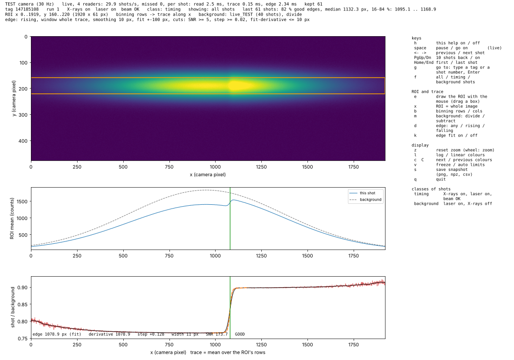

# Time tool

The X-ray pulses and the pump laser jitter against each other by tens of femtoseconds. The
**time tool** (SACLA's arrival-timing monitor) measures this shot by shot: an optical probe
passes a target in which the X-rays change the transmission, and a camera (an OPAL, IPX
or CHET detector, e.g. 1920 x 540 pixels) records the probe. Where the X-rays arrive, the probe
shows a step: the **edge**. Its position on the camera gives the shot's arrival time.

SILAS has its own time-tool analysis, the same live at the beamline and offline on the
HPC, working directly on the camera images. It can be compared shot by shot with SACLA's own
timing-monitor analysis (see [Checked against SACLA](#checked-against-sacla)).

## In short

| Step | Command | Where |
|---|---|---|
| 1. Look at the camera, set the ROI | `start_tt_viewer(run=N)`, `set_tt_roi(...)` | HPC (live: `start_tt_viewer()`) |
| 2. Background | `set_tt_background(run=N)` | HPC (live: `capture_tt_background()`) |
| 3. Check the edges | `start_tt_viewer(run=N)` | HPC / beamline |
| 4. Calibration (a scan of the time-tool motor) | `calibrate_tt(scan)` | HPC |
| 5. Edge of every tag | `make_tt_log()` or `qsub .../tt_logger_job.sh` | HPC (live: `start_tt_logger()`) |
| 6. Use it | `load_tt(run)` | anywhere |

The settings are stored in the config (`timetool` section) and shown by `show_tt()`; a running
viewer or logger follows changes made in the session.

## How a shot is analysed

Every shot is analysed on its own (`silas.core.timetool`), with the same code in the
viewer, the loggers and the batch scripts:

1. **Trace.** The mean of the ROI's rows (`binning="rows"`: one value per camera column, a
   trace along x) or of its columns (`binning="cols"`: along y).
2. **Corrected trace.** The trace divided by the background's trace (`mode="divide"`, the
   default) or minus it (`"subtract"`), with the same ROI and binning.
3. **Edge.** Found in the corrected trace (see [The edge](#the-edge)), in **camera pixels**:
   it does not move when the ROI changes.
4. **Correction.** With a calibration (motor = P(edge), see [Calibration](#calibration)):
   `shift = P(edge) - P(0)`, in the units of the delay motors (pulse).
5. **Timing.** `timing = scanned delay motor + shift` (pulse); `x ps_per_pulse` gives ps.

Everything is kept in **pulses** of the delay motors until the end; `ps_per_pulse` (default
0.006671: 1 pulse = 1 um of stage, the light passes it twice) converts to ps
(`set_tt_time(ps_per_pulse)`).

### Shot classes

Each shot gets a class from the SyncDB flags:

| Class | Meaning |
|---|---|
| timing | X-rays on, laser on, beam status OK: the edge is measured |
| background | laser on, X-rays off |
| xray only | X-rays on, laser off |
| other | neither, or a flag not readable |

"X-rays on" is the X-ray shutter (`xfel_shutter`, 0 = closed). The time-tool laser has no
flag by default (always on), for setups where its probe does not go through the pump
shutter. If it has a shutter of its own: `set_tt_laser("<detector>", on_value=1)`.

## Camera, ROI and the viewer

```python
start_tt_viewer(run=1234501)       # HPC: step through a stored run's shots
start_tt_viewer()                  # beamline: live (new terminal, 1 display + 4 readers, MPI)
start_tt_viewer(test=True)         # a made-up camera (laptop, or to try the keys)
set_tt_roi(0, 1919, 160, 220)      # x0, x1, y0, y1, camera pixels
set_tt_roi()                       # the whole image
set_tt_binning("rows")             # trace along x ("cols": along y)
set_tt_camera("OPAL-...")          # the camera's detector ID, only if the first OPAL / IPX / CHET is not the one
```



The window shows one shot: the camera image with the ROI; the ROI's trace with the
background's trace; the corrected trace with its smoothed version and the fitted step. The
edge is a vertical line in both trace plots (solid: the edge, green when good, red when not;
dotted: the derivative's edge), and its numbers (edge, step, width, SNR, why not good, the
correction in pulses) are in the bottom plot. The status lines show the shot (tag, run,
flags, class), ROI, binning, background and edge settings; live also the readers' speed and
the edges of the last shots (fraction good, median, 16-84 %).

**Offline** the run's flags are read once, then one shot at a time is read when you move.
**Live** the readers (MPI processes) share the newest shots and find the edge of every shot;
the display keeps the last 900 (30 s) and reads the image of the shot it shows. Live flags
reach the SyncDB a few seconds after the image, so the newest shots show "?" at first.

| Key | |
|---|---|
| `h` | help on / off |
| space | pause / go on (live) |
| `←` `→` / PgUp PgDn / Home End | previous / next shot; 10 back / on; first / last |
| `g` | go to: type a tag or a shot number, Enter (Esc cancels) |
| `f` | all shots / timing shots / background shots |
| `e` | draw the ROI with the mouse (drag a box; `e` again cancels) |
| `x` | ROI = whole image |
| `b` | binning rows / cols |
| `m` | background: divide / subtract |
| `d` | edge direction: any / rising / falling |
| `k` | edge fit on / off |
| `z` `l` `c` `C` `v` | reset zoom (wheel zooms); log colours; colour map; freeze colour limits |
| `s` | snapshot: `<output>/timetool/snapshots/` (png, npz, csv: image, traces, edge) |
| `q` | quit |

## Background

The mean image of a background run. Its trace is made with the current ROI and binning
whenever needed, so a new ROI needs no new background.

```python
set_tt_background(run=1234479)                      # HPC: all shots of a stored run (6 processes)
set_tt_background(run=1234479, shots="background")  # only shots with the X-ray shutter closed
capture_tt_background(shots=300)                    # beamline: live; block the X-rays first
capture_tt_background(shots=300, only_xray_off=True)
set_tt_background(mode="subtract")                  # or "divide" (default)
set_tt_background(file=".../background_....npz")    # a saved one again
set_tt_background(clear=True)
```

By default all shots of the run are averaged, as SACLA's timing-monitor tool does: the X-rays
of a background run can be blocked by something the flags do not show (e.g. a shutter further
upstream, with the X-ray shutter flag open in every shot). Check in the viewer that none of its
shots shows an edge; `shots="background"` takes only the shots flagged as X-rays off.
Saved to `<output>/timetool/background_<camera>_<source>_<time>.npz`.

## The edge

For each corrected trace (`find_edge`):

1. **Derivative.** The trace is smoothed with a Gaussian (sigma `smooth_px`, 10 px) and
   differentiated; its largest value of the wanted sign (`direction`, default `rising`) in the
   search `window` is the derivative edge, refined to a fraction of a pixel.
2. **Fit.** Within +-`fit_range_px` (100 px) of it, a smooth step on a straight line,
   `a + c (x - x0) + b (1 + tanh((x - t) / w)) / 2`, is fitted by least squares on a grid (t in
   0.5 px steps within +-10 px, w from 2 to 80 px; a, b, c exact for each), so it always
   converges. t, refined to a fraction of a pixel, is the edge; b the step height, w its width.
3. **Good** when the SNR (derivative peak / its noise away from the edge) >= `min_snr` (5), the
   step >= `min_step` (0.02, i.e. 2 % in divide mode), fit and derivative agree within
   `max_diff_px` (10 px), and the edge is not at the window border.

`direction="rising"` is the default because with `"any"` a steep slow slope can win over the
real edge; choose the direction your setup gives. Without a background the edge is looked for in the raw trace and
is never good.

```python
set_tt_edge(direction="rising", window=(600, 1800), smooth_px=10, fit=True, fit_range_px=100,
            min_snr=5, min_step=0.02, max_diff_px=10)      # only the ones given change
```

## Calibration

A calibration scan moves the time-tool delay motor (at BL3 e.g.
`xfel_bl_3_st_1_motor_73/position`) one step per run, and the edge moves across the camera. `calibrate_tt` fits the polynomial
**motor = P(edge)**:

```python
calibrate_tt(1234480)                               # the scan containing run 1234480 (run log)
calibrate_tt(runs=range(1234480, 1234497))          # without the run log
calibrate_tt(1234480, order=2, min_good=20, max_tags=100, save=False)
```

Per step: the edges of all good timing shots (a histogram per step, `histograms.png`), their
median and 16-84 % range, against the motor's set value (the median over the run). The
polynomial is fitted to the step medians (steps with fewer than `min_good` good edges are left
out) and stored in the config; from then on every shot's correction uses it.
`calibration.png` shows set value against edge with all good shots and the residuals. Files:
`<output>/timetool/calibration_<runs>_<time>/` (`shots.csv`, `steps.csv`, `calibration.json`,
the plots).

## The time-tool log

The edge of every tag of every run, written run by run like the run logger. The analysis
takes each shot's correction from it.

```python
make_tt_log()                                     # HPC: every finished run from first_run, then stop
make_tt_log(last_run=1234551)                      # ... up to that run
make_tt_log(first_run=1234501, last_run=1234551, follow=True)   # as if live: wait for new runs
start_tt_logger()                                 # beamline: live (new terminal; 1 writer + 2 readers, MPI)
tt_logger_status()                                # is one running, which runs are done
df = load_tt(1234501)                             # one row per tag, with the correction
```

As an HPC batch job (it follows new runs until the walltime or `qdel`; `LAST_RUN` stops it
after that run, to try it on old data as if live):

```bash
qsub ~/SILAS/scripts/tt_logger_job.sh
qsub -v FIRST_RUN=1234501,LAST_RUN=1234551 ~/SILAS/scripts/tt_logger_job.sh
tail -f ~/SILAS/output/tt_logger_job.log
```

**HPC**: a run is done once it is stopped; it is split into parts of about 500 tags for a
pool of 6 processes (a line of progress per part), and its file is written when its parts are
done. Runs without the camera are noted and skipped. Runs logged with other settings are kept
(`make_tt_log(redo_changed=True)` does them again; the scan analysis redoes the runs it needs).

**Starting again**: a logger stopped in any way (Ctrl-C, a crash, the end of a batch job) simply
continues when started again. The HPC logger skips the runs already in `index.csv` (each run is
noted there as soon as its file is written); the beamline logger finishes the runs left open
(it appends the new tags of the current run and skips a line cut short by the stop). Only
`rebuild=True` starts from scratch. A lock left by a killed logger is taken over (same computer:
its process is gone; another computer: no heartbeat for 10 minutes).
**Beamline**: readers take the newest shots from the online storage; the writer gives every
tag its run, appends to the run's file every 2 s and closes a run 10 s after it stopped, noting
the shots missed. Online the shot class is not known yet (`cls = -1`); missed shots can be
filled in on the HPC later with `make_tt_log`.

Files in `<output>/timetool/edges/`:

| File | |
|---|---|
| `run_<run>.csv` | per tag: `tag`, `edge` (camera pixel), `edge_deriv`, `edge_fit`, `step`, `width`, `snr`, `good`, `cls` (0 timing, 1 background, 2 X-rays only, 3 other, -1 unknown), `sid` (id of the settings: ROI, binning, background, edge) |
| `index.csv` | per run: status (`done`, `online`, `no camera`), tags, edges, good, timing shots, `sid`, camera, seconds, written |

The correction is **not** stored: `load_tt(run)` adds `shift_pulse = P(edge) - P(0)` and
`shift_ps` from the current calibration (NaN where the edge is not good), so a new calibration
needs no new log. Only rows made with the current settings are returned.

## Checked against SACLA

`compare_tt_sacla` puts our edges next to those of SACLA's `TimingMonitorAnalyzer`
(its result files `<run>.csv` and `<run>.tma.h5`) for the same tags, and with a calibration
also the timing of every shot, ours (`motor + P(edge) - P(0)`) against a linear calibration of
SACLA's (`csv[3] - slope x csv[2]`, default slope 0.0026 ps / px over 0.00666 ps / pulse;
`--sacla-slope` on the command line):

```python
cfg.set("timetool.sacla_dir", "/path/to/TMA/csv")   # once: the folder of SACLA's <run>.csv files
compare_tt_sacla(runs=[1234501, 1234502], max_tags=300)
compare_tt_sacla(1234501)              # the whole scan; files: <output>/timetool/compare_<runs>_<time>/
compare_tt_sacla(1234501, sacla_dir="/other/folder")   # another folder for this comparison
```

Per run it gives the shots good in both, the median and robust spread of the edge difference
ours - SACLA and their correlation; `compare.png` and `delay.png` show them shot by shot. With
the same settings (ROI, background, edge cuts) the two analyses should agree within about a
pixel. A constant offset of the timing only moves time zero (the two calibrations differ). SACLA's
files for runs that have none are made with
`TimingMonitorAnalyzerCUI <settings file> <first run> <last run>` (with your settings file and
its output folders set to your own).

## Speed

On the HPC one process (`tests/probe_tt_speed.py`) needs about 3 ms to read a shot, 1 ms for the
trace and 2-5 ms for the edge, so it does more than 100 shots/s, several times SACLA's 30 Hz. The
batch scripts and loggers use several processes (`workers`, default 6 on the HPC, 2 readers live)
and print their speed.

## Commands

| Command | |
|---|---|
| `show_tt()` | the settings |
| `start_tt_viewer(run=None, test=None, workers=4, camera=None)` | the viewer (live / offline) |
| `set_tt_roi(x0, x1, y0, y1)`, `set_tt_binning(b)`, `set_tt_camera(id)`, `set_tt_laser(det, on_value)` | camera settings |
| `set_tt_background(run=, shots=, mode=, file=, clear=, workers=, max_shots=)` | background from a stored run |
| `capture_tt_background(shots=300, only_xray_off=False, test=None)` | background live |
| `set_tt_edge(direction=, window=, smooth_px=, fit=, fit_range_px=, min_snr=, min_step=, max_diff_px=)` | edge finding |
| `calibrate_tt(which, runs=, motor=, unit=, order=1, min_good=20, workers=6, max_tags=, show=True, save=True, mpi=False)` | calibration |
| `set_tt_time(ps_per_pulse=0.006671)` | pulse -> ps |
| `make_tt_log(first_run=, last_run=, follow=False, rebuild=False, workers=6)`, `start_tt_logger(test=, workers=2)`, `tt_logger_status()` | the time-tool log |
| `load_tt(run)` | a run's log with the corrections |
| `compare_tt_sacla(which, runs=, sacla_dir=, workers=6, max_tags=, show=True, mpi=False)` | against SACLA (`sacla_dir`: default `timetool.sacla_dir`) |

`workers` are processes of a pool; `mpi=True` starts the batch scripts under mpirun instead
(falling back to the pool if mpirun cannot start).

## Settings in the config

Section `timetool` (missing keys take the defaults):

| Key | Default | |
|---|---|---|
| `detector` | `null` | camera ID; `null`: the first OPAL / IPX / CHET of the run |
| `roi` | `null` | `[x0, x1, y0, y1]` camera pixels, inclusive; `null`: whole image |
| `binning` | `"rows"` | `"rows"`: trace along x; `"cols"`: along y |
| `laser_detector`, `laser_on_value` | `"none"`, `1` | time-tool laser flag; `"none"`: always on |
| `background.file`, `.source`, `.mode` | `null`, `null`, `"divide"` | the background and how it is used |
| `edge.direction`, `.window`, `.smooth_px`, `.fit`, `.fit_range_px` | `"rising"`, `null`, `10`, `true`, `100` | edge finding |
| `edge.min_snr`, `.min_step`, `.max_diff_px` | `5`, `0.02`, `10` | cuts for a good edge |
| `calibration` | `null` | from `calibrate_tt`: motor, unit, `coef` (numpy.polyval), edge range, rms, source |
| `ps_per_pulse` | `0.006671` | ps per pulse |
| `sacla_dir` | `null` | folder of SACLA's `TimingMonitorAnalyzer` results, for `compare_tt_sacla` |
| `display.*` | | viewer colours, limits, `update_s` |
